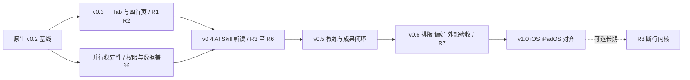

# Inkflow 总体路线与交付计划

当前构建、失败修复与设备覆盖见[2026-11-27 实施验收记录](../../android/IMPLEMENTATION_2026-11-27.md)。分项通过不能替代整阶段放行。

更新：2026-11-27。状态：**已批准并进入实现，已有分项回归通过，部分实现/完整验收仍缺；整包未放行**。本文是 v0.2 基线至 v1.0 的唯一开发排期入口；文档落库不代表功能交付。

## 依据与优先级

依据已批准的外部 `inkflow_master_roadmap_plan.md`（2026-11-27）、用户实施授权、仓库原生代码和既有验收整理。当前处于 IMPLEMENT 实施与集成阶段；本文保留产品规范、依赖及状态，具体构建和验收结果由独立报告记录。

约束优先级：用户明确确认 → [原生 AI 契约](../architecture/native-ai-contract.md) → 本总计划及三份专项规范 → [R1–R8 引擎规划](inkflow-reader-engine-v2.md)和旧专项。旧 Flutter 文档中的“已实现”只表示原端事实，不能作为原生完成依据。

| 正式规范 | 负责范围 |
| --- | --- |
| [UI 结构与规格](inkflow-ui-structure-and-specs.md) | 三 Tab、四种首页、书架/我的/设置、App/阅读双层皮肤、手机/平板布局 |
| [AI 交互与 Skill](inkflow-ai-interaction-and-skills-spec.md) | 问书、来源、六 Agent、Skill 生态、范围授权、任务与成果 |
| [阅读交互](inkflow-reader-interaction-spec.md) | 手势仲裁、选区、划线、TTS、来源返回、多端一致性 |
| [阅读引擎 R1–R8](inkflow-reader-engine-v2.md) | 缓存、绘制、听读、动画、触摸、复杂内容、排版和长期内核 |
| [主动阅读教练](ai-active-reading-coach.md) / [闭环缺口](reading-loop-closure-gaps.md) | v0.5/v0.6 的详细产品需求与原生状态映射 |

## 已确认且不可降级的交付条件

1. 纯原生 KMP `:core` + Android Compose；iOS/iPadOS 使用 SwiftUI。没有 React Native 业务层。正文默认原生分页，复杂出版内容保留直连 ZIP 的本地 WebView 兜底。
2. 一级导航固定 **首页｜书架｜我的**。知识、词汇、洞察与设置归“我的”；宽屏 Rail 与手机表达同一三项导航。
3. v0.3 **经典、壁纸沉浸、极简、E-INK 四种首页一次交付**，包含桌面设置和恢复偏好；不能先交一款、其余标作完成或无限延期。
4. 普通屏尽量贴近两段参考录屏的结构、比例、层次、入口及操作顺序；E-INK 使用相同语义的静态路径。需真机/模拟器与参考逐项比较后才能声称接近，视觉通过结论以对应构建的独立验收记录为准。
5. **稳定性与 UI 并行**。不以“稳定性以后做”为由先交外观，也不以稳定性为由取消已确认的四首页。每个阶段都带连续阅读、位置恢复、无额外模型调用的回归门槛。
6. 全书生成支持**一次明确授权同一冻结任务**，分批执行；**单独授权查看全部成果**。生成授权和展示授权相互独立，默认展示仍防剧透，不改变阅读进度。
7. 跨页选区默认用显式按钮；拖边扩选仅为可选增强、默认关闭、E-INK 禁用。始终保留不依赖拖拽的等价操作。
8. 界面语言固定中、英、日、韩四语；跟随系统/手动选择延续现有本地化边界，语言切换不重建阅读现场、不调用模型。
9. 复用 SQLite **v22** 的现有实体、任务 payload、Evidence、动作日志与投影；新增偏好以 **`native/settings.json` v5** 扩展，继续读取 v1–v4。历史验收基线捕获版本为 v4；现有 v5 写入、v1–v4 恢复及 Skill/本机偏好隔离已有定向设备回归，不代表所有设置组合已验收。
10. 同步/恢复仅沿用 WebDAV、自托管 HTTPS 进度和本地 ZIP。凭据及本次查看全部授权不进备份/同步；派生分页缓存可重建，不作为用户成果备份。

## 状态口径与 v0.2 基线

- **已有实现/有范围验收**：代码和已链接报告支持该具体能力，仍受报告设备、版本和时长限制。
- **已实现待验收**：对应能力已有实现代码，尚无当前集成版本的完整验收结论；不能据此放行阶段。
- **部分实现**：已有部分实现，但目标交互、平台接入或完整闭环尚不齐全；已有部分仍需验收。
- **待实现**：对应能力尚无实现，或条目明确指出的剩余子能力尚未落地；不能仅因缺验收报告就把已有代码归入此类。
- **待验收**：已有实现尚缺本阶段所需证据；与待实现分开记录。
- **长期可选**：尚未承诺交付，不阻塞其余里程碑。

下表区分 2026-11-26 历史验收基线与 2026-11-27 实现及分项回归。原生代码提交 `dcc3606d`，最终生产/test integration24：core 225/225、两变体 JVM 各 200/200，两生产 APK 与两测试 APK 构建成功；lint 每变体 140 项、0 错误/缺失翻译，808 个英语基础资源的中日韩键/格式检查无差异。API31 standard 最终完整套件 262 通过、21 条件跳过、0 失败；API34 fullOcr 为 266 通过、17 条件跳过、0 失败。最终 360dp/大字号/深色四语与实书定向 5/5 通过，并修复日/韩语引擎选项挤压；API34 宽屏分项及所有测试范围见实施报告。

真实全书生成、物理 WiFi/锁屏音频/Bluetooth、两小时连续阅读、同设备前后性能比较和 iOS/iPadOS 对齐仍有缺口；跳过不计通过。分项检查不能代替整阶段验收，M0–M7 不得据此全部标为完成。

| 能力 | 基线事实与真实状态 | 证据 |
| --- | --- | --- |
| 独立 Android、KMP、原生分页/本地兜底 | 已有实现/有范围验收；不能推导所有格式所有章节稳定 | [迁移说明](../../android/NATIVE_MIGRATION.md)、[迁移计划](../../android/NATIVE_MIGRATION_PLAN.md) |
| 连续阅读与恢复 | 已修跨章末页和重叠段落样式；模拟器连续 1802.43 秒、300 次翻页通过 | [持续阅读报告](../../android/CONTINUED_TEST_2026-11-26.md)；不代表数小时/所有真机通过 |
| 历史离线套件 | 2026-11-26：core 123/123；两变体 JVM 各 70/70；API31 standard 154 通过/15 跳过；API34 fullOcr 158 通过/11 跳过；均 0 失败 | 同上；条件跳过不能计为通过 |
| 真实模型对话 | OpenAI/Anthropic 私网模型对话与流式保存已有范围验收 | [实机报告](../../android/LIVE_TEST_2026-11-26.md)；不等于生成内容质量通过 |
| 已读章节 Wiki/Atlas/建议笔记任务 | 已有 scheduler、Evidence、checkpoint、暂停恢复；真实结构化输出仍出现无效 JSON | 持续报告：失败任务保留 3 个 checkpoint；不能标整书完成 |
| 三 scope 与全书授权/查看全部 | 三 scope、独立查看授权已接入；API31/34 各 13 项生成及 10 项 preflight 回归已有记录，完整 UI/真实模型范围矩阵仍待验收 | [GenerationAuthorization](../architecture/native-ai-contract.md#generation-scope-extension-contract-2026-11-27) |
| 原生闭环/图谱/笔记整理 | 部分实现：既有成果投影、静态关系图、局部下一行动和建议确认 | [P1 说明](../architecture/native-reading-p1.md)；非完整主动教练 |
| 中英日韩界面 | integration24 新增页面四语资源检查及紧凑截图审查通过；宽屏有分项回归，完整视觉矩阵及母语全文审校仍缺 | [多语言报告](../../android/LOCALIZATION.md)；未完成母语全文审校 |
| 三 Tab、四首页、录屏级 UI、六 Agent/双格式 Skill | 三 Tab/四首页已接入，四语 × 四风格及书架动作有设备回归；六 Agent 中五个可用、教练禁用，完整工具/UI 验收仍缺 | 专项规范中的代码映射；不得把十 Skill 当六 Agent 已完成 |
| 偏好备份 | v5 往返、v1–v4 恢复、旧 Skill 回退与本机偏好隔离已有 10 项设备回归；完整设置矩阵仍待验收 | [NativeSettingsBackup.kt](../../android/app/src/main/kotlin/com/aceinandroid/inkflow/NativeSettingsBackup.kt) |
| iOS/iPadOS | 原生骨架及编译检查已有；运行时/XCFramework 真链接和全功能验收未完成 | [iOS 验证](../../ios-native/VALIDATION.md) |

## 五条主线与编号任务

每项都须关联实施代码、真实验证和限制后才能改成完成。R 编号保留，不另起一套引擎编号。

| 编号 | 可实施交付单元 | 依赖/阶段 | 当前状态 |
| --- | --- | --- | --- |
| S1 | 固定连续阅读回归：跨章末页、段落样式、旋转/后台/强停后 CFI 精确恢复 | 每阶段；v0.3 起并行 | 既有修复有范围验收，后续持续门禁 |
| S2 | 已读/选章/全书授权、payload v2、v1 默认已读、读源/调用/写入三复核 | 复用 gateway/scheduler；v0.4 | 三 scope、持久任务/源指纹/重试前校验已有分项设备验收；完整 UI 与真实模型范围矩阵待验收 |
| S3 | Wiki/Atlas schema 同供应商最多一次纠正，失败保留 checkpoint 与可用成果 | S2、Evidence；v0.4，v0.5 消费 | 同供应商一次纠正、失败 checkpoint 已实现并有夹具回归；实际模型结构化质量待验收 |
| S4 | v22 复用；偏好 v5 写入及 v1–v4 恢复、未知字段/类型保留策略与凭据隔离 | U1/U2、A4；v0.3–v0.4 | v5 往返、v1–v4 恢复及凭据/本机偏好隔离已有定向回归；未知字段/类型和完整设置矩阵仍须按范围核验 |
| S5 | 四语、两变体、E-INK、屏幕与外部服务的分层验证 | 每阶段，外部生态 v0.6 | integration24 四语资源及两变体构建、两 API 完整回归通过；紧凑/宽屏有分项验收，完整视觉矩阵、E-INK/真机/外部服务仍缺 |
| U1 | 三 Tab/Rail 路由重组；知识/词汇/统计/设置迁入我的，保留深链和返回现场 | v0.3 | 三 Tab/Rail 路由已实现待验收；返回/深链完整性待新验收 |
| U2 | 四首页全部、桌面设置、最近书、时间/座右铭/金句/历程及本地空态 | U1/S4；v0.3 同批交付 | 四风格与桌面设置已实现，普通手机四语 × 四风格及空态动作通过；完整布局/恢复待验收 |
| U3 | 三列书架、多选、导入、详情、我的双列卡与分组设置 | U1、v22 书库；v0.3 | 自适应书架、多选与全屏详情已实现；全选/取消及确认批量删除、阅读/听书回调已有设备验收 |
| U4 | App 浅/深/系统与阅读五皮肤双层主题；原生 tokens、五图标底栏、AI｜听 | v0.3，听书扩展 v0.4 | 双层主题已接入；integration21 定向回归及紧凑英语截图确认 AI 跟随 App 深色、阅读纸色独立，完整视觉矩阵待验收 |
| U5 | 手机单页/宽屏双页与左书右 AI；面板和正文身份稳定 | R1/R2、A1；v0.4 | 双页/面板调宽已接入；API34 宽屏 8 项真实双页/高亮绘制回归通过，完整正文身份、字符锚与响应式 UI 联动仍待验收 |
| A1 | AI 问书高占比 Sheet、透明执行状态、角标/来源折叠卡、QueryBack | Evidence、U5/I4；v0.4 | 部分实现：问书/来源 UI 已有新增代码；完整轨迹、角标与 QueryBack 待新验收 |
| A2 | 六 Agent 注册和本地工具路由；每轮仅选所需能力 | 现有 workload/Skill；v0.4 | 六 Agent 已注册、五个可用，未完成的教练保持禁用；完整工具路由与交互待验收 |
| A3 | 本地冷启动三条问题、回答附带追问、进度变化本地失效 | A2；v0.4 | 待实现；翻页零模型是硬约束 |
| A4 | .md/.skill.md/.json 解析、编辑、导入导出、四入口、全局/单书绑定、同步冲突 | S4、现 Registry；v0.4 | 双格式、本机绑定、WiFi 确认队列与增量同步已接入；备份/收件箱/冲突恢复及多设备多轮同步有回归，旧无来源副本/ZIP 恢复仍可能多一份冲突副本；真实 WebDAV/物理 WiFi 待验收 |
| A5 | 已读成果默认/本书本次查看全部、范围确认与来源可见性统一投影 | S2/S3；v0.4，v0.5 丰富 | Scope/本书本次查看授权已接入，源导航按当前授权复核有设备回归；完整查看 UI 与真实模型范围矩阵待验收 |
| I1 | 深色主胶囊+三样式五颜色副胶囊、保留选区、动作与撤销 | R2；v0.3 | 部分实现：分层绘制/批注样式与选区 UI 已新增代码；完整交互和撤销待新验收 |
| I2 | 显式跨页扩选为默认；三层候选仲裁、圆形放大镜、可选拖边 | R5；v0.4 | 显式控制、gesture/edge core 及原生 pointer/手柄/放大镜已接入；实际拖动/拖边设备验收待完成，E-INK 禁用拖边/放大镜 |
| I3 | 全屏听书、句级同步、跨页去抖、听当前与迷你播放器 | R3；v0.4 | 部分实现：播放器、位置/设置与听读同步已有新增代码；真实播放、焦点与生命周期待新验收 |
| I4 | 统一来源导航、原提问位置锚、重复引用返回及生命周期保留 | A1、R1；v0.4 | 有来源返回基础；完整 QueryBack 待验收 |
| I5 | 动画/亮度/书签/表格公式/双字体/自动阅读 | R4/R6 v0.4；R7 v0.6 | 依各 R 项部分实现/待实现 |
| C1 | AI 大纲与安全 Wiki 联动；选章/全书已授权任务接入统一成果目录 | A5、S3；v0.5 | 待实现 |
| C2 | 零键盘检视、四问题、章节自测、难点与五级知识卡复习 | 既有 v22 成果/动作；v0.5 | 本地目标、经选区验证的难点、来源验证知识卡复习及 30 天冲突安全撤销已有分项回归；不启用 AI 教练，完整闭环及知识卡增量同步仍缺 |
| C3 | 完成归档、可执行下一行动、悬念→线索→揭示闭环 | C2、统一 Artifact；v0.5 | 局部 resolver/投影已有，闭环待实现 |
| C4 | Token 按能力/书/模型归因、本机健康度；真实/估算分开 | gateway usage；v0.5 | 成功请求日志及八维归因已有实现和分项测试；失败尝试/重试、价格及完整 UI 验收仍缺 |
| C5 | 三会话证据后偏好候选、用户确认才生效、跨设备 confirmed/rejected | C2、既有 Profile 边界；v0.6 | 待实现 |
| C6 | SwiftUI 三 Tab/四首页、iPad 双页/AI、Skill/备份对齐及运行验收 | 核心契约、v0.3–v0.6；v1.0 | 骨架已有，功能对齐待实现 |

## R1–R8 保留与阶段对照

| 编号 | 不变的能力范围 | 阶段/状态 |
| --- | --- | --- |
| R1 | 配置指纹、页边界持久化、渐进页码、可见字符锚；含宽屏尺寸/栏数键 | v0.3，缓存/原生分页已接入，恢复与失效有定向回归；20 次真实打开/100 次翻页有性能样本，缺同设备改动前基线，比较门禁仍开放 |
| R2 | Background / Underlay / Content / Overlay / Interactive 五层、行级合并、三样式划线 | v0.3，分层绘制/行级批注已接入，真实双页/高亮绘制有分项回归；完整五层职责与视觉/性能仍需逐项核验 |
| R3 | TTS 句级 offset、高亮、跨页 pendingTurnCharPos、反向暂停/从选区起播 | v0.4，听读同步/位置和播放器代码部分实现，真实播放与跨页行为待新验收 |
| R4 | Slide/Cover/可选仿真/None、独立亮度、快捷书签，兼容双页 | v0.4，设备本机亮度/跟随系统及退出恢复已有 5 项设备回归；完整动画/书签菜单及双页组合仍待实现或验收 |
| R5 | 统一触摸仲裁、显式扩选、可选拖边、放大镜 | v0.4，显式扩选已有、gesture/edge core 状态机已实现；原生 pointer/手柄/放大镜已接入，实际拖动/拖边设备验收待完成；E-INK 禁用拖边/放大镜 |
| R6 | 局部表格/公式离屏渲染回插、主题缓存、失败兜底 | v0.4，待实现 |
| R7 | 中英双字体、本地智能选词、自动阅读暂停原因集合 | v0.6，CJK/Latin 字体及缓存身份已有分项验收；本地词表与自动阅读暂停协调仍待实现 |
| R8 | UAX#14、禁则/连字符/Knuth-Plass 等可替换断行内核 | v1.0 之后仍可选，不作 v1.0 强制门禁 |

## 里程碑、依赖与放行

| 阶段 | 完整交付包 | 依赖与放行条件 | 真实状态 |
| --- | --- | --- | --- |
| v0.2 | 原生迁移基线和已记录修复 | 以上历史报告的有限结论 | 已有范围验收；存在生成/外部生态/iOS 缺口 |
| v0.3 | U1–U4、I1、R1/R2、S4 的首页/主题备份部分 | 四首页一起可用；三 Tab 路由；位置恢复、四语/E-INK；UI 与 S1 同步验收 | 多项代码已实现待验收或部分实现，整包未放行 |
| v0.4 | A1–A5、S2/S3、U5、I2–I5、R3–R6、v5 完整覆盖 | 三 scope 与查看全部严格隔离；同供应商一次纠正；双页/听读/Skill 链路齐全 | 多项代码已实现待验收或部分实现，整包未放行 |
| v0.5 | C1–C4、教练/归档/复习/悬念闭环 | 依赖 v0.4 生成与安全投影；用户确认与撤销逐项可用 | 原生局部基础已有，整包待实现 |
| v0.6 | R7、C5、真实 WebDAV/API/在线 TTS 与真机长读 | 不用离线夹具代替外部服务；四语母语审校单列缺口 | 待实现/待外部验收 |
| v1.0 | C6、平台能力对齐、共享核心真链接/XCTest、升级与发布质量 | 每平台每能力有真实证据；缺能力明确列出 | 待实现/待平台验收 |



并行不等于跳过依赖：UI 可用离线固定数据完成布局与交互，但不得伪造真实生成、引用或任务通过。v0.5 的生成消费依赖 v0.4 的权限/纠错；底层契约先可审阅，再接页面。

## 每阶段 Definition of Done

- 功能：交付包所有必选项可执行；空/加载/失败/部分成功/取消/恢复/离线状态都有明确出口，不留下死按钮。
- 架构：请求注册、角色/fallback、ContextAssembler、任务安全点、精确 Evidence、授权动作和领域投影同一链路；新扩展点先落契约，不以页面分支绕行。
- 稳定性：本阶段影响到的阅读/CFI/批注/来源/备份做最小定向回归，随后适用的 JVM、lint、两 APK；保持用户书库，不通过改进度或清空数据获得通过。
- 产品：手机与 ≥840dp 宽屏、中英日韩、大字号、深浅模式和 E-INK 可操作；按专项规格比对参考片段，记录偏差；截图必须来自本阶段真实构建。
- 数据：v22 数据、v1–v4 恢复到 v5、Skill 定义兼容与绑定本机隔离、未知 kind/task 保留及失效授权拒绝；凭据不外泄。
- 证据：写明代码版本、设备/变体、命令、通过/失败/跳过、时长及未覆盖项。没有真实模型/TTS/外部 WebDAV/iOS runtime 证据时保持待验收。

以下为集成验证命令模板；实际执行版本、结果与缺口由独立验收报告记录，不由命令模板推定通过：

```sh
cd android
./gradlew :core:jvmTest :app:testStandardDebugUnitTest :app:testFullOcrDebugUnitTest
./gradlew :app:lintStandardDebug :app:lintFullOcrDebug :app:assembleStandardDebug :app:assembleFullOcrDebug
```

设备测试使用对应变体 AndroidTest APK 与已隔离的测试数据。真实付费/外部服务仅按授权环境显式启用；不能将条件跳过当通过。文档改动检查使用 `git diff --check` 与相对文件链接校验。
